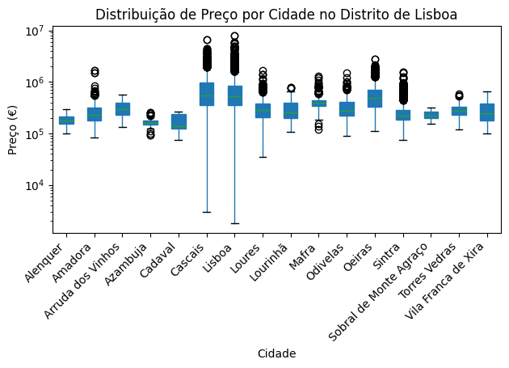

# Lisbon Real Estate Price Prediction

Predicting the sale price of apartments and duplexes in the Lisbon district from listing data, with exploratory analysis of what drives prices in one of Portugal's most expensive housing markets.

Team project for the *Programming Fundamentals* course, MSc in Data Science, ISCTE (2025/26), developed with Fernando Rocha and Frederico Ferreira.

## Data

[Portugal Real Estate 2024](https://www.kaggle.com/datasets/luvathoms/portugal-real-estate-2024) (Kaggle), about 120,000 property listings across Portugal, downloaded automatically with `kagglehub`. The analysis keeps only residential apartments and duplexes in the Lisbon district.

## Method

- **Cleaning:** filter to Lisbon, convert text booleans (parking, elevator), derive property `Age` from construction year, drop rows without price, remove implausible areas (kept 20 to 10,000 m²).
- **Model:** scikit-learn `Pipeline` with a `ColumnTransformer` (median imputation for numeric features, most-frequent imputation and one-hot encoding for city, town and type) and a `RandomForestRegressor`.
- **Validation:** 80/20 train/test split.

## Results (test set)

| Metric | Value |
|---|---|
| R² | **0.89** |
| MAE | €70,819 |
| RMSE | €153,036 |
| MAPE | 15.1% |

Number of bathrooms had the strongest correlation with price, followed by total area and number of rooms. Older properties tend to be cheaper.



## Repository structure

```
lisbon_real_estate.ipynb   # data download, cleaning, model, visualisations
report.pdf                 # full written report (Portuguese)
images/                    # figures used in this README
```

## How to run

```bash
pip install pandas numpy scikit-learn matplotlib seaborn kagglehub
jupyter notebook lisbon_real_estate.ipynb
```

The dataset is downloaded by the first cell (a Kaggle account may be required).

## Tech stack

Python · pandas · scikit-learn · matplotlib · seaborn

## Team

André Marques, Fernando Rocha and Frederico Ferreira. The full report with the team's methodology and discussion is in [`report.pdf`](report.pdf) (Portuguese).
